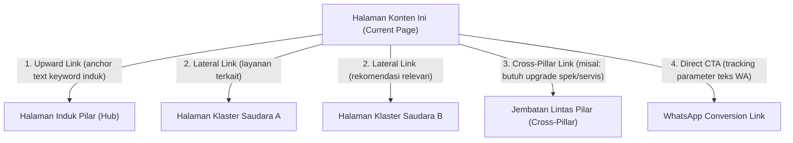

# 🔗 Matriks Tautan Internal & Aturan Canonical Devk

> **Standar Arsitektur Silo, Hub-Spoke, & Keterhubungan Konten**  
> Setiap halaman baru **DILARANG BERDIRI SENDIRI (ORPHAN PAGE)**. Satu konten wajib tertaut dan saling mendukung konten lain dalam arsitektur Topical Authority.

---

## 1. Aturan Baku Canonical URL

Untuk menghindari kanibalisasi kata kunci dan duplikasi konten (*duplicate content issues*):

1. **Format Absolut Wajib**:  
   Semua tag canonical harus menggunakan format URL absolut dengan domain utama:  
   `https://devk.my.id/<slug>`
2. **Pembersihan Parameter Query**:  
   Tag canonical **tidak boleh** memuat query string seperti parameter tracking (`?utm_source=...`), parameter pencarian (`?q=...`), atau pagination sementara.
3. **Penanganan Trailing Slash**:  
   Situs menggunakan format **tanpa trailing slash** di akhir URL (contoh: `/jasa-install-autocad-online`, bukan `/jasa-install-autocad-online/`).
4. **Sinkronisasi Schema.org**:  
   Field `@id` dan `url` pada JSON-LD Schema.org (`WebPage` & `ProfessionalService`) wajib identik 100% dengan Canonical URL.

---

## 2. Aturan Tautan Internal Wajib (4-Point Linking Rule)

Setiap halaman klaster (spoke) atau artikel blog yang dibuat **WAJIB** menerapkan 4 jenis tautan keluar internal:

### Penjelasan 4 Jenis Tautan:
1. **Upward Link (Ke Halaman Pilar Induk)**:
   * Menghubungkan kembali otoritas ke halaman layanan utama.
   * *Contoh*: Di halaman AutoCAD, wajib ada tautan ke Hub `/jasa-install-software-online`.
2. **Lateral Links (Ke 2 Halaman Klaster Saudara)**:
   * Menahan pengunjung agar menjelajahi ekosistem software serupa (*lower bounce rate*).
   * *Contoh*: Di halaman AutoCAD, wajib menautkan ke `/jasa-install-sketchup-vray-online` dan `/jasa-install-software-arsitektur-online`.
3. **Cross-Pillar Bridge (Jembatan Lintas Pilar)**:
   * Menghubungkan masalah klien ke solusi lain yang disediakan Devk.
   * *Contoh Solutif*: *"Jika laptop Anda terasa berat atau sering overheating saat menjalankan software CAD, kami juga melayani [servis laptop dan upgrade SSD di Surabaya & Sidoarjo](/jasa-servis-laptop-panggilan-surabaya-sidoarjo)."*
4. **Direct Conversion CTA**:
   * Tombol tindakan ke WhatsApp dengan parameter teks khusus agar tim sales tahu dari halaman mana prospek berasal:
     `https://wa.me/6285799520350?text=Halo%20Devk,%20saya%20tertarik%20dengan%20[NAMA_HALAMAN]`

---

## 3. Matriks Pemetaan Halaman, Keyword, & Hubungan Tautan

| URL / Slug | Fokus Keyword Utama | Kategori Silo | Tautan Wajib Masuk (Inbound From) | Tautan Wajib Keluar (Outbound To) |
| :--- | :--- | :--- | :--- | :--- |
| `/` (Homepage) | Jasa Pembuatan Software & Install Komputer | Root | Semua Halaman (via Header/Logo) | Pilar 1, Pilar 2, Pilar 3 |
| **`/jasa-pembuatan-software`** | jasa pembuatan software custom | **Pilar 1 (Hub)** | Homepage, Footer, Klaster P1 | `/jasa-pembuatan-aplikasi-pos-kasir`, `/jasa-pembuatan-crm`, `/jasa-install-software-online` |
| `/jasa-pembuatan-aplikasi-pos-kasir` | jasa pembuatan aplikasi pos kasir toko | Klaster P1 | Pilar 1, Blog POS Kasir | Pilar 1, `/jasa-pembuatan-crm`, `/jasa-install-komputer-surabaya-sidoarjo` |
| `/jasa-pembuatan-crm` | jasa pembuatan crm custom indonesia | Klaster P1 | Pilar 1, Blog CRM | Pilar 1, `/jasa-pembuatan-aplikasi-pos-kasir`, `/contact` |
| **`/jasa-install-software-online`** | jasa install software online remote | **Pilar 2 (Hub)** | Homepage, Footer, Klaster P2 | `/jasa-install-autocad-online`, `/jasa-install-sketchup-vray-online`, Pilar 3 |
| **`/jasa-install-autocad-online`** | jasa install autocad online bergaransi | Klaster P2 | Pilar 2, Homepage, Blog CAD | `/jasa-install-software-online`, `/jasa-install-sketchup-vray-online`, `/jasa-servis-laptop-panggilan-surabaya-sidoarjo` |
| `/jasa-install-sketchup-vray-online` | jasa install sketchup vray online remote | Klaster P2 | Pilar 2, Halaman AutoCAD | `/jasa-install-software-online`, `/jasa-install-autocad-online`, `/jasa-install-software-arsitektur-online` |
| `/jasa-install-adobe-creative-cloud-online` | jasa install photoshop premiere illustrator online | Klaster P2 | Pilar 2, Footer | `/jasa-install-software-online`, `/jasa-install-macbook-imac-surabaya` |
| **`/jasa-install-komputer-surabaya-sidoarjo`** | jasa install komputer surabaya sidoarjo | **Pilar 3 (Hub)** | Homepage, Footer, Klaster P3 | `/jasa-install-ulang-windows-surabaya-sidoarjo`, `/jasa-install-macbook-imac-surabaya`, `/jasa-servis-laptop-panggilan-surabaya-sidoarjo` |
| `/jasa-install-ulang-windows-surabaya-sidoarjo` | jasa install ulang windows surabaya sidoarjo | Klaster P3 | Pilar 3, Homepage, Klaster P2 | Pilar 3, `/jasa-servis-laptop-panggilan-surabaya-sidoarjo`, `/jasa-install-software-online` |
| `/jasa-install-macbook-imac-surabaya` | jasa install macbook imac surabaya sidoarjo | Klaster P3 | Pilar 3, Halaman Adobe | Pilar 3, `/jasa-install-ulang-windows-surabaya-sidoarjo`, `/jasa-install-autocad-online` |
| `/jasa-install-linux-surabaya` | jasa install linux server desktop surabaya | Klaster P3 | Pilar 3 | Pilar 3, `/jasa-pembuatan-software` |
| `/jasa-servis-laptop-panggilan-surabaya-sidoarjo` | jasa servis laptop panggilan surabaya sidoarjo | Klaster P3 | Pilar 3, Halaman Windows, Halaman CAD | Pilar 3, `/jasa-install-ulang-windows-surabaya-sidoarjo`, `/jasa-install-komputer-surabaya-sidoarjo` |

---

## 4. Standar Anchor Text (Teks Jangkar)

* **Variasi Wajib**: Gunakan kombinasi 50% keyword exact/LSI (contoh: *"jasa install autocad online"*), 30% nama brand/topik (contoh: *"layanan software teknik Devk"*), dan 20% conversational (contoh: *"cek daftar harga selengkapnya di sini"*).
* **Hindari Over-Optimization**: Jangan gunakan anchor text yang sama 100% secara berulang-ulang di satu halaman.
* **Konteks Alami**: Tempatkan tautan di dalam kalimat deskriptif yang memberi nilai tambah bagi pembaca.
