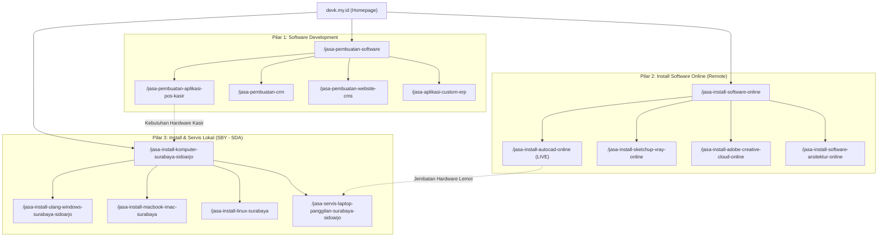

# 🗺️ Master SEO & Content Roadmap Devk (2026–2027)

> **Dokumen Panduan Strategis & Operasional Konten**  
> **Brand**: Devk Software Development & IT Services  
> **Domain**: [https://devk.my.id](https://devk.my.id) | Admin CMS: [https://software.devk.my.id](https://software.devk.my.id)  
> **Hotline / WhatsApp**: 085799520350 ([https://wa.me/6285799520350](https://wa.me/6285799520350))  
> **Workshop Sidoarjo**: Graha Indraprasta G7/15, Sidoarjo  
> **Workshop Surabaya**: Jl. Tenggilis Mulya 76, Surabaya  
> **Terakhir Diperbarui**: Oktober 2026  
> **Status**: Dokumen Induk Aktif (Wajib dipatuhi oleh seluruh Kontributor & Agen AI)

---

## 1. Visi, Positioning, & Target Pasar

Website **Devk** diposisikan sebagai platform solusi teknologi ganda (hybrid service):
1. **Lini Pengembangan Perangkat Lunak (Software House)**: Menyediakan solusi B2B berupa aplikasi kustom, sistem kasir (POS), CRM, dan website profesional berkinerja tinggi.
2. **Lini Layanan Teknis & Instalasi Software (Digital & Local Services)**:
   - **Jasa Install Software Online (Jarak Jauh / Remote)**: Melayani kebutuhan instalasi software berat (CAD, 3D, Desain Grafis, Video Editing, Office) ke seluruh Indonesia via AnyDesk / TeamViewer.
   - **Jasa Install & Servis Komputer Lokal (Surabaya - Sidoarjo)**: Melayani instalasi sistem operasi (Windows, macOS, Linux), maintenance kantor, servis panggilan rumah/kantor, serta upgrade hardware (SSD/RAM).

---

## 2. Tiga Pilar Layanan Utama (Topical Pillars)

---

## 3. Rencana Eksekusi Bertahap (Content Release Phases)

### Fase 1: Fondasi & Quick Wins (Bulan 1)
- [x] Rilis Landing Page: **Jasa Install AutoCAD Online** (`/jasa-install-autocad-online`) dengan modul visual dan konten mendalam.
- [x] Rilis Landing Page Pilar 2: **Hub Jasa Install Software Online** (`/jasa-install-software-online`) (LIVE).
- [x] Rilis Landing Page Pilar 3: **Hub Jasa Install & Servis Komputer Surabaya Sidoarjo** (`/jasa-install-komputer-surabaya-sidoarjo`) (LIVE).
- [x] Rilis Landing Page Pilar 1: **Hub Software Development** (`/jasa-pembuatan-software`) (LIVE).
- [ ] Setup schema dasar `LocalBusiness` & `ProfessionalService` di seluruh halaman layanan.

### Fase 2: Klaster Software Remote Nasional (50+ Software Katalog Lengkap)
- [x] **CAD & Teknik Sipil**: AutoCAD, SketchUp, Revit, SAP2000, ETABS, PLAXIS 2D/3D, Civil 3D, ArchiCAD, SolidWorks, Inventor (LIVE).
- [x] **3D Modeling & Rendering**: Lumion Pro, 3ds Max, Blender, Enscape, Cinema 4D, D5 Render, Twinmotion, Maya, Arsitektur 3D (LIVE).
- [x] **Desain Grafis & Vektor**: Adobe Photoshop, Illustrator, InDesign, Clip Studio Paint, Affinity Suite, CorelDRAW (LIVE).
- [x] **Video Editing & Audio DAW**: Premiere Pro, After Effects, DaVinci Resolve Studio, CapCut Pro PC, Filmora, VEGAS Pro, FL Studio, Ableton Live (LIVE).
- [x] **Statistik, Skripsi & GIS**: IBM SPSS Statistics, SmartPLS, EViews, Minitab, ESRI ArcGIS Pro, MATLAB Simulink (LIVE).
- [x] **Perkantoran & PDF**: Microsoft Office 365/2024, Adobe Acrobat Pro DC, Nitro Pro PDF, Foxit PDF Editor (LIVE).
- [x] **Development & BI**: Navicat Premium, Tableau Desktop, Power BI, Docker Desktop & WSL2 (LIVE).
- [x] **Utility & Data Recovery**: EaseUS Data Recovery, AOMEI Backupper, IDM Pro, Driver Booster Pro (LIVE).
- [x] Integrasi internal linking silang antara layanan online dengan solusi servis lokal.

### Fase 3: Pilar Software House & Solusi B2B (SELESAI & LIVE)
- [x] Rilis Landing Page Pilar 1: `/jasa-pembuatan-software` (LIVE).
- [x] Rilis Halaman Spesifik B2B Klaster Pilar 1:
  - [x] `/jasa-pembuatan-aplikasi-pos-kasir` (Sistem Kasir Toko & Ritel Multi-Cabang - LIVE).
  - [x] `/jasa-pembuatan-crm` (Custom CRM & Otomasi Pipeline WhatsApp - LIVE).
  - [x] `/jasa-pembuatan-website-cms` (Website Company Profile Modern Skor PageSpeed 100 - LIVE).
  - [x] `/jasa-aplikasi-custom-erp` (Sistem Custom ERP Manufaktur & Supply Chain - LIVE).
- [x] Rilis Klaster Servis Komputer & OS Lokal (Surabaya - Sidoarjo):
  - [x] `/jasa-install-ulang-windows-surabaya-sidoarjo` (LIVE).
  - [x] `/jasa-install-macbook-imac-surabaya` (LIVE).
  - [x] `/jasa-install-linux-surabaya` (LIVE).
  - [x] `/jasa-servis-laptop-panggilan-surabaya-sidoarjo` (LIVE).
  - [x] `/jasa-rakit-pc-surabaya-sidoarjo` (LIVE).
- [x] Rilis Klaster Geo-Targeted Lokal Spesifik 3 Kota (Sidoarjo, Surabaya, Mojokerto) — 18 Halaman LIVE:
  - [x] **Sidoarjo**: `/jasa-install-windows-10-sidoarjo`, `/jasa-install-windows-11-sidoarjo`, `/jasa-install-software-macbook-sidoarjo`, `/jasa-install-software-windows-sidoarjo`, `/jasa-install-linux-sidoarjo`, `/jasa-install-dual-boot-sidoarjo` (LIVE).
  - [x] **Surabaya**: `/jasa-install-windows-10-surabaya`, `/jasa-install-windows-11-surabaya`, `/jasa-install-software-macbook-surabaya`, `/jasa-install-software-windows-surabaya`, `/jasa-install-linux-surabaya`, `/jasa-install-dual-boot-surabaya` (LIVE).
  - [x] **Mojokerto**: `/jasa-install-windows-10-mojokerto`, `/jasa-install-windows-11-mojokerto`, `/jasa-install-software-macbook-mojokerto`, `/jasa-install-software-windows-mojokerto`, `/jasa-install-linux-mojokerto`, `/jasa-install-dual-boot-mojokerto` (LIVE).
- [x] Produksi 6 Aset Visual Material Design CTA (+Nomor WA 085799520350 + Paket Pricing Plan) terdaftar di Media Library.
- [ ] Publikasi 4 artikel blog studi kasus penerapan sistem POS & CRM untuk bisnis ritel/F&B.

### Fase 4: Dominasi Kata Kunci Long-Tail & Edukasi (Bulan 4+)
- [x] Rilis 5 Panduan Troubleshooting Teknis Otoritatif & Bebas Clickbait (Batch 1 - LIVE):
  - [x] `/posts/panduan-mengatasi-autodesk-licensing-error-adsklicensing` (Autodesk Licensing Error AdskLicensing Service & C++ Repair).
  - [x] `/posts/cara-mengatasi-lumion-crash-saat-render-4k-tdrdelay` (Lumion Crash 4K Render, TdrDelay Registry & VRAM Pagefile).
  - [x] `/posts/panduan-lengkap-uji-asumsi-klasik-regresi-linear-spss` (Uji Asumsi Klasik SPSS: Normalitas, Multikolinearitas, Heteroskedastisitas, Autokorelasi).
  - [x] `/posts/panduan-aman-dual-boot-windows-11-ubuntu-24-04-lts` (Dual-Boot Windows 11 & Ubuntu 24.04 LTS: BitLocker, Fast Startup, EFI GPT, GRUB).
  - [x] `/posts/laptop-panas-90-derajat-thermal-throttling-solusi-pasta-kering` (Laptop Panas 90°C Thermal Throttling, Pump-Out Effect & Deep Cleaning).
- [ ] Rilis 7 artikel blog pendukung lanjutan (DirectX error, panduan memilih laptop arsitektur, dll.).
- [ ] Optimasi kecepatan (Core Web Vitals) dan penguatan backlink berotoritas lokal.

---

## 4. Metrik Keberhasilan & KPI SEO

| Metrik | Target 3 Bulan | Target 6 Bulan | Sumber Data |
| :--- | :--- | :--- | :--- |
| **Halaman Terindeks Sempurna** | 100% halaman terbit | 100% tanpa error | Google Search Console |
| **Top 3 Ranking (Keyword Lokal)** | 5 Keyword Utama SBY-SDA | 15+ Keyword Lokal | Search Console / SERP Tracker |
| **Top 5 Ranking (Keyword Online/Remote)** | "jasa install autocad online" | 10+ Keyword Software CAD/Editing | Search Console |
| **Click-Through Rate (CTR)** | > 4.5% | > 7.0% | Google Search Console |
| **Konversi Leads WhatsApp** | 20+ Chat Order / Bulan | 60+ Chat Order / Bulan | Tag Manager / WhatsApp Business |

---

## 5. Tata Kelola & Referensi Dokumen Terkait

Seluruh kontributor dan agen wajib membaca dokumen pelengkap di folder ini sebelum memproduksi konten:
* [`LINKING_MATRIX.md`](./LINKING_MATRIX.md) — Aturan Canonical, Silo, & Struktur Internal Linking
* [`CONTENT_GUIDELINE.md`](./CONTENT_GUIDELINE.md) — Panduan Gaya Bahasa, Komposisi Blok, & Standar Gambar
* [`TEMPLATE_PAGE.md`](./TEMPLATE_PAGE.md) — Skema JSON Payload Pembuatan Halaman Baru Emdash
